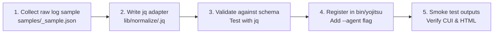

# AGENTS.md - Developer & AI Agent Guide for `yojitsu.zsh`

This document defines the core design principles, coding conventions, shared schema specifications, and adapter contribution workflows for both AI coding agents (Claude, Copilot, Antigravity, etc.) and human contributors working on `yojitsu.zsh`.

---

## 1. Core Philosophy

1. **Minimal Dependencies**
   - The primary execution stack strictly relies on `zsh` and `jq`.
   - Avoid adding dependencies on Python, Node.js, Ruby, or external package managers. The tool must execute out-of-the-box in standard macOS and Linux shell environments.

2. **Decoupled Two-Stage Architecture**
   - All variations and differences in AI agent log formats MUST be absorbed within the normalization layer (`lib/normalize/*.jq`).
   - The reporting layer (CUI table and HTML generator) MUST only ingest the Common Benchmark JSON. Agent-specific parsing logic must never leak into reporting modules.

3. **Static & Standalone Visualizer**
   - HTML, CSS, and JS for web reports reside as pre-built static files in `templates/` without requiring any build step (Webpack, Vite, npm, etc.).
   - Simply supplying the Common JSON allows interactive rendering with Chart.js and expandable step-by-step accordions directly in local browsers.

---

## 2. Common Data Schema (v1.0.0)

Every normalization filter (`lib/normalize/<agent>.jq`) must output a JSON object (or an array of objects) strictly conforming to the following structure:

### JSON Schema Overview

```json
{
  "version": "1.0.0",
  "metadata": {
    "agent": "agy | claude | copilot | other",
    "timestamp": "ISO-8601 string (e.g. 2026-10-05T00:30:00Z)",
    "target_repo": "Path to workspace/repo (optional)",
    "run_id": "Unique run identifier (optional)"
  },
  "benchmark": {
    "id": "Prompt identifier (e.g. P1_simple)",
    "title": "Short title or variant description",
    "prompt": "Raw prompt text submitted to the agent",
    "model": "Model name (e.g. gemini-2.5-pro, claude-3-7-sonnet)",
    "effort": "Reasoning effort (low | medium | high | xhigh | max | default)",
    "elapsed_sec": 0.0,
    "exit_code": 0
  },
  "tokens": {
    "input_tokens": 0,
    "output_tokens": 0,
    "total_tokens": 0,
    "cache_read_tokens": 0,
    "cache_write_tokens": 0,
    "breakdown": {
      "prompt_tokens": 0,
      "cmd_tokens": 0,
      "base_context_tokens": 0,
      "cache_read_tokens": 0,
      "thought_tokens": 0,
      "response_tokens": 0
    }
  },
  "cost": {
    "currency": "USD",
    "estimated_cost_usd": 0.0
  },
  "tools": [
    {
      "step": 1,
      "tool": "Tool name (e.g. run_command, view_file, grep)",
      "command": "Summary of command executed",
      "args": {},
      "output_chars": 0,
      "consumed_tokens": 0,
      "output_preview": "First ~160 characters of tool stdout/output"
    }
  ],
  "tool_calls_count": 0,
  "thinking": "Full thinking / chain-of-thought (CoT) text",
  "response": "Final agent answer / text response"
}
```

### Estimation & Fallback Rules
When raw logs lack specific token fields, use the following fallback calculations:
- **Missing Token Count**: Estimate based on character length divided by 2.5:
  `max(1, (length / 2.5) | floor)`.
- **`thought_tokens` and `response_tokens`**:
  - If reasoning tokens are explicitly reported in usage metadata, use that value.
  - Otherwise, estimate `thought_tokens` from `thinking` text length. Set `response_tokens = max(0, output_tokens - thought_tokens)`.
- **`base_context_tokens`**:
  - Calculated as: `max(0, input_tokens - prompt_tokens - cache_read_tokens - cmd_tokens)`.

---

## 3. Directory Layout & Responsibilities

```text
yojitsu/
├── bin/
│   └── yojitsu               # Main CLI entrypoint (subcommand dispatcher)
├── lib/
│   ├── common.zsh            # ANSI colors, path resolution, error handling
│   ├── normalize/            # Agent-specific normalization filters
│   │   ├── agy.jq
│   │   ├── claude.jq
│   │   └── copilot.jq
│   ├── report_cui.zsh        # CUI formatted summary table
│   └── report_html.zsh       # Static HTML/CSS packaging logic
├── templates/
│   ├── index.html            # Dashboard HTML skeleton
│   ├── style.css             # Dashboard styling
│   └── app.js                # Chart.js rendering & accordion logic
├── samples/                  # Fixture files for testing
│   ├── agy_stream_sample.json
│   ├── claude_sample.json
│   └── common_sample.json
├── README.md                 # User documentation
└── AGENTS.md                 # This developer & agent guide
```

---

## 4. Implementation & Coding Conventions

### 4.1. `zsh` Scripting Guidelines
- **Strict Mode**: Every shell script must begin with:
  ```zsh
  #!/usr/bin/env zsh
  set -euo pipefail
  ```
- **Function Namespacing**:
  - To prevent symbol collisions, all functions must be explicitly namespaced using double colons (`::`).
  - Use the module/file path relative to `lib/` as the namespace:
    - **Public functions**: `yojitsu::<module>::<function_name>`
      - Example (`lib/common.zsh`): `yojitsu::common::log_error`
      - Example (`lib/report_cui.zsh`): `yojitsu::report_cui::render_table`
      - Example (`lib/normalize/agy.zsh`): `yojitsu::normalize::agy::parse`
    - **Private functions** (internal to the file): `__yojitsu::<module>::<function_name>` (prefixed with double underscore `__`)
      - Example: `__yojitsu::report_cui::format_cell`
  - *Note*: Double colons (`::`) are fully valid identifier characters in `zsh`, cleanly distinguishing namespace separators from snake_case words. The `__` prefix avoids conflicts with standard zsh completion functions (which use a single `_`).
- **Local Scope**: Always declare function-local variables with `local`:
  ```zsh
  yojitsu::common::my_function() {
    local target_file="$1"
    local result
    ...
  }
  ```
- **Portability**:
  - Accommodate differences between macOS (BSD coreutils) and Linux (GNU coreutils).
  - Avoid non-portable flags like `sed -i` without backup arguments; prefer `awk`, `perl -pi -e`, or temporary file redirection.
  - Rely on `printf` for table formatting to maintain alignment independently of `column -t` version differences.

### 4.2. `jq` Scripting Guidelines
- **Modular Filters**:
  - Write complex JSON transformations inside dedicated `lib/normalize/<agent>.jq` files and invoke them via `jq -f`.
- **Null Safety & Guard Defaults**:
  - Never allow missing keys to cause filter crashes. Use `// empty`, `// 0`, or `// ""`:
  ```jq
  .usage.prompt_tokens // .usage.input_tokens // 0
  ```
- **Stream JSON (NDJSON) & Single JSON Compatibility**:
  - Use `inputs` or `[inputs]` so scripts seamlessly accept both newline-delimited JSON (`stream-json`) and single JSON documents.

### 4.3. HTML / CSS / JavaScript Guidelines
- **Vanilla JavaScript**:
  - Write ES6+ that runs directly in modern browsers without compilation or bundlers.
- **Local File Protocol (`file:///`) & CORS**:
  - Browsers often block `fetch('benchmark_data.json')` when opening HTML directly via `file:///`.
  - Support both:
    1. Direct file loading via an inline `<script id="benchmark-data" type="application/json">` injection.
    2. Or writing out `benchmark_data.js` containing `const BENCHMARK_DATA = [ ... ];` included via `<script src="benchmark_data.js">`.
    3. A lightweight `yojitsu serve` option for hosting the output directory via `python3 -m http.server` or similar.
- **Styling**:
  - Sleek dark theme (Background: `#090d16`, Cards: `#111827`, Accents: `#38bdf8`, `#a855f7`).
  - Chart.js (v4) loaded from CDN.

---

## 5. Step-by-Step Guide: Adding a New Agent Adapter

Follow this workflow to add support for a new AI coding agent (e.g. `cline`, `aider`, `cursor`):



1. **Capture Raw Logs**:
   - Save sample agent outputs to `samples/<agent>_sample.json`.
2. **Implement `lib/normalize/<agent>.jq`**:
   - Map raw JSON fields (model, elapsed time, tokens, tool invocations, thinking, response) to the Common Schema.
3. **Verify Common Schema Output**:
   - Execute: `jq -f lib/normalize/<agent>.jq samples/<agent>_sample.json` and verify schema compliance.
4. **Register in CLI**:
   - Wire the agent name into `yojitsu run --agent <agent>`.
5. **Verify Reports**:
   - Confirm that `yojitsu run` prints the CUI table and generates the HTML dashboard cleanly.

---

## 6. Testing & Quality Assurance

- **Golden Output Tests**:
  - Maintain fixture inputs in `samples/` and verify normalization outputs match expected common JSON structures.
- **CUI Smoke Tests**:
  - Pipe sample Common JSON through `lib/report_cui.zsh` to ensure zero errors and correct terminal formatting.
